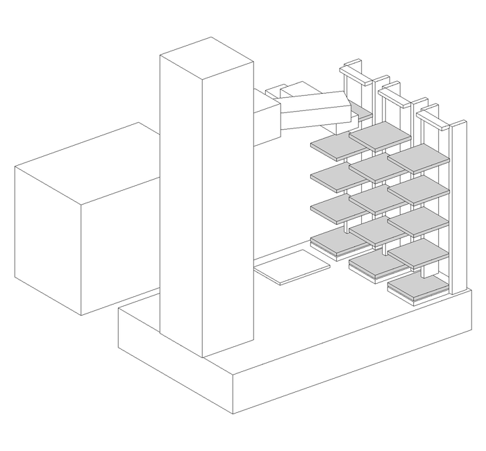
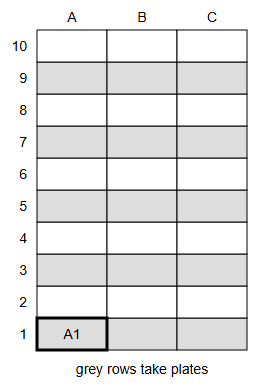

# Polar workcell

Setup script for the Bioyond Polar arm with a plate hotel and a rotation module. This is the version for the arm without cameras.

## Prerequisites

- A 64-bit Windows PC.
- BioyondWorks, installed on the PC. Close it before you start: the arm takes one program at a time.
- Python 3.10 or newer, 64 bit, from python.org. Tick "Add python.exe to PATH" in its installer.
- The .NET Desktop Runtime 8 (x64), from https://dotnet.microsoft.com/download/dotnet/8.0.
- The Bioyond Python package, `bioyondsdk-0.1.1-py3-none-any.whl`. Contact us or Bioyond to get it. It is how the arm is driven, so every cell needs it.
- Squid, if a microscope is part of the cell. Start it and tick Settings > Enable MCP Control Server.

Open a Command Prompt or PowerShell and `cd` into this folder, the one that holds `cli.py`. Every command below is run from there. In PowerShell, write `.\cli` where this page says `cli`.

Install, once. Put the path to the .whl file in the line:

```bat
setup\install.bat "C:\path\to\bioyondsdk-0.1.1-py3-none-any.whl"
```

It creates the environment, installs the packages and ends with a check of the PC and the cell. Every line that says `FAIL` has the fix under it. Run the check again at any time:

```bat
cli doctor
```

These are plain batch files: Windows runs them without any script permission, and nothing has to be activated.

A PC with no internet: copy the packages of `setup\requirements.txt` (as .whl files) into `setup\vendor\wheels\` and run the same line.

## Hardware


1. Connect the power cable and the emergency stop to the arm. Turn on the main switch at the back. Wait until the status light is steady.
2. Connect the PC to port 1 of the controller with a network cable.
3. Screw the hotel onto the platform. The slots face the arm. Leave it empty.
4. Keep one plate at hand.

Then load the plates into the hotel. Start at A1.



## Setup

```bat
cli setup
```

The script ends with `READY`.

It starts by connecting: it finds the arm on the network, enables it, and asks Squid whether it answers. If one of them does not answer, the script says what to do and waits: do it, press Enter, and it tries again. For an arm that has no microscope yet: `cli setup --no-squid`.

Then the script asks you to show the arm eight places with the plate: slots A1, A9, B1, B9, C1 and C9, then the rotation module twice (short edges, then long edges). The arm ends above the rotation module.

Each time:

1. The arm goes loose.
2. Fit the gripper onto the plate until the finger pads sit in the plate's grooves.
3. Press Enter.

## Setup script in a nutshell

- Connect: the arm found, connected and enabled; Squid answering
- User shows the arm eight places with a plate:
    - six hotel slots; the hotel is fitted through them
    - rotation module seats, short edges and long edges; the arm then finds each seat's angle by force
- Planner: routes from each slot ↔ rotation module
- Upload to the arm:
    - hotel slot positions
    - rotation module seat positions
    - long-edge grip, short-edge grip, and grip torque probe procedure
    - hotel slot exit/entry procedure
    - routes from each slot ↔ rotation module

# Teaching

## Hardware

1. Place the microscope next to the platform, at least 20 cm from the arm's base. The plate holder must be within 39 cm of the arm's axis.
2. Start Squid. Tick Settings > Enable MCP Control Server.
3. Place a real plate in the microscope's plate holder.

## Teaching

```bat
cli teach
```

1. Squid asks for permission in its own window: click Yes. The stage goes to Squid's loading position, then the arm goes loose.
2. Fit the gripper onto the plate's short edges until the finger pads sit in the plate's grooves.
3. Press Enter. The arm lifts above the seat and the script ends with `READY`.

## Teaching and route planning script in a nutshell

- Squid: stage to its loading position
- Arm: jaw set for the plate's short edges, then loose
- User: fits the gripper onto the plate in the microscope
- Planner: microscope seat ↔ rotation module routes
- Upload routes and microscope seat to the arm
- Arm: ends above the seat

# Running jobs

## Demo

Put a plate in slot A1. Take the plate out of the microscope's holder.

```bat
.venv\Scripts\python demo.py
```

The arm takes the plate from A1 to the microscope and back. Nothing looks at the seats: the script trusts that A1 holds a plate and that the microscope's holder and the rotation module are empty.

## Your own script

```python
from polar import Polar

arm = Polar(plate_at="A1")

arm.move("A1", "microscope")
arm.move("microscope", "A1")
```

- `arm.move(source, destination)` picks the plate at the source and places it at the destination.
- `arm.pick(place)` and `arm.place(place)` do one half each.
- `plate_at` says where the plate is when the script starts. Leave it out and the arm remembers from the last run.
- A place is a hotel slot (`"A1"` to `"B9"`), `"module"`, or the name of an instrument you taught. Column C does not work yet.
- Each call returns when the arm is done. It raises an error with the reason if it cannot do it.

## With a running microscope

In Squid, tick Settings > Enable MCP Control Server. The first time the arm goes to the microscope, Squid asks for permission in its own window: click Yes.

```python
from polar import Polar, Microscope

arm = Polar(plate_at="microscope")
scope = Microscope()

arm.move("microscope", "A1")
arm.move("A3", "microscope")
scope.acquire("acquisition.yaml")
```

- Before the arm goes to the microscope, it waits for the acquisition to finish and sends the stage to Squid's loading position.
- After the arm has placed a plate there, the stage goes back to where the acquisition ended.
- `scope.acquire(path)` starts an acquisition saved by Squid (`acquisition.yaml`).
