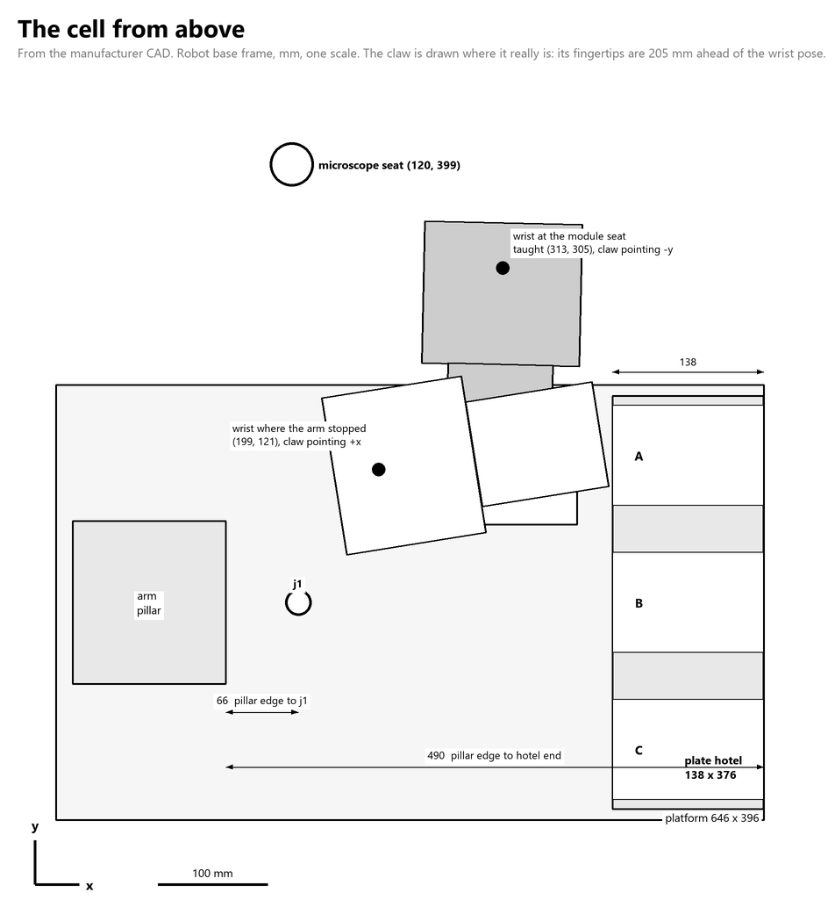
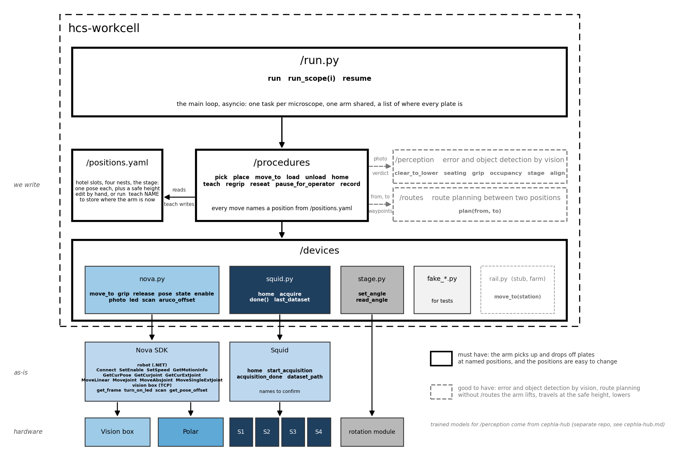

# hcs-workcell

Plate transfer cell on the Bioyond Nova SCARA arm: microscope stage, rotation module (the arm's own axis; `polar` in the code), plate hotel.
Vision-gated, state-persisted, built to run unattended for days and to log the data that later
prediction models train on.

## Documents

- `docs/REPLICATION.md`: rebuild the cell from hardware to an unattended loop, step by step.
- `docs/VENDOR_SDK.md`: what the vendor .NET SDK really does (measured).
- `DESIGN.md`: gates, damage prevention, tolerance model, data contract, failure cases, tests.
- `ANALYSIS.md`: results of the first 90-hour unattended run and the plan derived from it.
- `STATUS.md`, `tools/review_queue.py`: current state and decisions awaiting review.

## Setup

1. **Place the microscope** as in the diagram: its plate holder within about 20 mm of (123, 400), 240 to 420 mm from
   the arm base, clear air above it and nothing in the corridor to the rotation module. The hotel slots open toward -x.
   (`docs/PLACEMENT.md` has the table and the rules; `python tools/placement_diagram.py` redraws the figure.)

   

   The arm is drawn on its taught approach to the rotation module (two 200 mm links); grey boxes are the zones the
   safety check uses, the dashed outline is the arm's workspace.

   Distances in the robot base frame, mm (arm base at (126, 0), x to the right, y up), from the coordinates in the diagram:

   | from | to | distance | along x, along y |
   |---|---|---|---|
   | arm base | microscope seat (123, 400) | 400.0 | -3, +400 |
   | arm base | rotation module (317, 305) | 359.9 | +191, +305 |
   | microscope seat | rotation module | 216.0 | +194, -95 |
   | arm base | hotel column A (293, 137.5) | 216.3 | +167, +137.5 |
   | arm base | hotel column C (293, -137.5) | 216.3 | +167, -137.5 |
   | rotation module | hotel column A | 169.2 | -24, -167.5 |
   | hotel column A | hotel column C | 275.0 | 0, -275 |

   Slot x is 293 for the plate's centre; the slots open toward -x, so the arm approaches from the base side.

2. **Install** on a fresh Windows PC, from the program folder: `.\install.ps1` (add `-SdkWheel <the vendor .whl>` for the real
   arm, or `-Sim` on a PC with no cell). It makes a `.venv`, installs the pinned packages (`requirements.txt`) and runs the
   doctor. Activate with `.\.venv\Scripts\Activate.ps1`.
3. **Check** the PC and the cell any time with `python tools/doctor.py` (also `python cli.py doctor`; `--sim` for the PC and
   the files only). It reads only: it moves nothing, connects no second arm client and never prints the passwords. Every
   FAIL comes with the line that fixes it. Run the setup when it says READY.
4. **Connect** Squid, the arm and the vision box, and put the aruco practice plate on the rotation module, marker up.
5. **Run** `python cli.py setup` (add `--sim` to try it on the simulator). It prints every step with who does it: `computer`,
   `polar` (the arm), `nova` (the vision box), `squid`, and `user`. You do only the `user` steps, and press Enter when a
   step of yours is done. Before a section that moves the arm it asks "Hands clear?"; Enter to go, `q` to quit.

| section | what happens | where the result goes |
|---|---|---|
| connect | ports found, Squid homed (a Squid with no motors stays where it is), arm to the nest, module to 0 deg, camera over the module plate | the nest is `routes.nest` |
| cameras.toml | down camera: aruco read, lens and camera-to-gripper solved together, refused above 0.5 px / 1 mm, uploaded, checked from two poses | `vision.calibration` |
| hotel.toml | arm to the nest (the hotel view), front camera picture; then the camera goes to the slot position of rows 2 and 4, one at a time, and the cell is asked "is there a slot here, yes or no" until it knows by itself: slots there mean 30, none 15 | `setup.hotel`, `fixtures.hotel.rows` |
| swap | the aruco plate's tag, as seen from straight above the module, is the reference; **you** move the aruco plate to the microscope stage and put a real plate on the rotation module | `setup.module_tag`, `setup.plate_offset` |
| grips.toml | short and long grip closed on the real plate, accept bands, three carry-seat-regrip cycles | `gripper.closed`, `gripper.accept_band`, `setup.grips` |
| microscope.toml | stage limits and park position from Squid (skipped for a Squid with no motors); the arm goes straight above the stage and measures the tag against the module's; seat re-seated if it moved less than the zone allows | `squid.<name>`, `fixtures.<name>.pose`, `setup.microscope` |
| clear the stage | **you** take the aruco plate off the stage; the arm looks down and checks it is gone | |
| system_state.json | every hotel slot, module, microscope and gripper looked at | `contents` in `state_microscope.json` |
| test | module to stage, acquire, back, long-edge grip, to a free hotel slot | |

A refused check stops the run, prints what to fix and leaves that section's values as they were. Continue with
`python cli.py setup --from "grips.toml"` (`--skip cameras.toml` leaves a section out). The Squid it drives is the practice
one (no motors, nothing imaged) until `devices/squid.py` is wired in.
Not yet automatic: a route to a microscope that stands more than the zone's 2 mm from the taught seat, and the 15-slot
grip offset (`fixtures.hotel.grip_back_mm`).

**If something goes wrong.** To stop at the next step, create the file `runs/STOP` (delete it before running again). After
a collision or a controller fault run `python cli.py recover --nest`: it clears the controller's errors, enables the arm
locked, and takes it to the nest, a safe pose in front of the hotel (it backs out along the claw first if it touched
something; with a plate in the claw it stays where it is and says so). `python cli.py recover` alone leaves the arm loose,
to move by hand. The unattended loop writes `runs/COLLISION` after a collision and will not start again until you have
looked at the cell and deleted it.

**Where things are written.** Every run's log is `runs/<name>/events.jsonl`, with its pictures in `runs/<name>/images/`
(the setup's folder is `runs/setup_<date>_<time>`). The setup writes what it learned into `layout.json` (the `setup`,
`vision.calibration`, `gripper` and `fixtures` keys); `hardware.json` describes the machine (from the manufacturer's CAD) and
is not changed by the setup. `layout.json` holds the box's upload login under `vision.ssh`: keep it out of git.
Plate heights, measured with the caliper 2026-10-26: practice 14.50 mm, real 14.42 mm, real with lid 16.85 mm.

## Architecture



One repo, four parts we write, each calling only the boxes below it. `run.py` is the main loop (asyncio: one
task per microscope, one arm shared, a list of where every plate is). `layout.json` is the positions file: every
pose, floor, speed, limit, route and plate type, data not code, changed by editing it or by `cli.py record-pose`.
`procedures/` are the arm moves with the checks between them. `perception/` turns a photo into a verdict and
imports no device. `devices/` is one thin file per machine plus a fake for each. `routes/` plans the waypoints
between two positions. The dashed boxes are the good-to-haves, each in its first working form. Nova SDK and
Squid are used as they come. Trained models for `perception/` come from cephla-hub, a separate project.

## Cycle

```
microscope --pick(short edges)--> polar@0 --rotate 90--> pick(long edges) --> hotel slot
hotel slot --pick(long edges)--> polar@90 --rotate 0--> pick(short edges) --> microscope
```

Every fixture visit: travel, hover, vision check, lower, jaw action, jaw verification, lift, image.

## Layout

Each box calls only the boxes below it. The figure and the reasoning live in AI-docs/hcs-workcell.

```
run.py                     the main loop, asyncio: one task per microscope, one arm shared, a list of where every plate is
cli.py                     teaching, references, tests and one-microscope runs; positions, occupancy, goto
layout.json                the positions file: every pose, floor, speed, limit, route and plate type. Data, not code.

procedures/                the arm moves, with the checks between them
  cycle.py                 Cycle: pick, place, the step tables, outbound, inbound, run (one plate change on one microscope)
  motion.py                its arm moves, each checked; move_to(position)   grasp.py   its jaw: open, close, judge, centre
  gates.py                 its camera and health checks      hotel.py       its hotel slots: climb, slide, pick, place; plate_order
  corrector.py             bounded recovery actions        safety.py      speed profiles, workspace box, z floors
  state.py                 where the plate is (ledger)     telemetry.py   JSONL events + images per cycle
  recorder.py              camera video per run            plates.py      plate types: jaw widths, grab height
  positions.py             load/save the positions file    preflight.py   what must be taught before a run

perception/                photo in, verdict out. No device imports.
  lower_check.py           clear_to_lower, seating, grip: correlation against reference photos, enforced once trained
  occupancy.py             slot occupancy detector: two classes per slot, self-tested, enforced once ready
  predictor.py             pre-step checks and drift statistics
  hub.py                   cephla-hub: serve a pinned model; record every gate's photo, verdict and the step's outcome (opt-in)

devices/                   one thin file per machine, plus a fake for each
  nova.py                  the arm and the vision box, one import; arm(layout, sim=True) gives the fake
  arm.py                   the only module touching the vendor robot SDK      fake_arm.py    simulator with fault injection
  vision_box.py            vision box TCP client                             controller.py  Lua jobs on the controller
  stage.py                 rotation module (the arm's own axis; `polar` in the code)                            squid.py       Squid+ (call names to confirm)
  fake_squid.py            waits and does nothing                            rail.py        stub for a future farm

routes/                    waypoints between two positions
  plan.py                  plan(from, to): a taught route, else lift / travel at routes.safe_z_mm / lower, checked
  trajectory.py            hand-guided capture, multi-demo normalisation

lua/                       the program on the arm's controller (Bioyond template + our mod_Cell, data_cell, data_plate)
tests/                     rig.py (fake vision box, simulator layout), test_sim.py (one microscope), test_run.py (two microscopes, one arm),
                           test_routes.py, test_occupancy.py, test_plates.py, test_hub.py
```

## Commissioning order

1. `python cli.py status`
2. Teach poses while hand-guiding: `python cli.py record-pose microscope`, `polar.pose_at_0`, `polar.pose_at_90`
3. Record each route 2 to 3 times: `python cli.py trace microscope_to_polar` (stop: create `runs/trace.stop`), then `python cli.py normalise microscope_to_polar`; same for `polar_to_hotel`
4. Record "safe to lower" references at each fixture hover: `python cli.py record-ref microscope plate_present` (3 or more each) for states `plate_present` and `empty`, plus `gripper short_edges` / `gripper long_edges` from the front camera
5. Set the microscope region box and z floor in `layout.json`
6. `python cli.py run --mode supervised --slot A1 --cycles 1`
7. Only after the acceptance tests in DESIGN.md: `--mode unsupervised`

## Teaching quickly

`python tools/teach_daemon.py` holds the one SDK connection and records a pose per word written to `runs/teach_cmd.txt`
(`A1`, `polar.pose_at_90`, `microscope`, `drag`, `undrag`, `status`, `quit`); `python tools/record_slot.py A3` does one
hotel slot without the daemon. Both store pose, joints, jaw, stage reading and a frame from each camera under
`reference_images/teach/`. Hotel rows above 1 are reached by retreating to `fixtures.hotel.climb_x`, climbing with
the column only, and sliding in at carry height; `--slot random` draws from `fixtures.hotel.active_slots`.

A pick that stalls wider than the plate starts a tactile centering search (`fixtures.<name>.grasp_search`): the seat
is walked in small steps along z, yaw, x and y until the fingers meet the plate at its width, and the working pose
is written back to `layout.json`.

## Tests

`python tests/test_sim.py` runs the full cycle, a refused move, a missed grasp, a blocked lowering and a half-finished resume, all offline.
