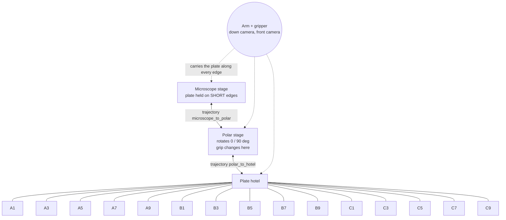

# hcs-workcell

Plate transfer cell on the Bioyond Nova SCARA arm: microscope stage, rotating (polar) stage, plate hotel.
Vision-gated, state-persisted, built to run unattended for days and to log the data that later
prediction models train on.

## Documents

- `docs/REPLICATION.md`: rebuild the cell from hardware to an unattended loop, step by step.
- `docs/VENDOR_SDK.md`: what the vendor .NET SDK really does (measured).
- `DESIGN.md`: gates, damage prevention, tolerance model, data contract, failure cases, tests.
- `ANALYSIS.md`: results of the first 90-hour unattended run and the plan derived from it.
- `STATUS.md`, `review_queue.py`: current state and decisions awaiting review.

## Topology



The arm is not a node. It is the agent that moves along the edges; the nodes are the places a plate can rest.
Each edge is one taught trajectory, replayed forward and in reverse.

## Cycle

```
microscope --pick(short edges)--> polar@0 --rotate 90--> pick(long edges) --> hotel slot
hotel slot --pick(long edges)--> polar@90 --rotate 0--> pick(short edges) --> microscope
```

Every fixture visit: travel, hover, vision check, lower, jaw action, jaw verification, lift, image.

## Layout

Each box calls only the boxes below it. The figure and the reasoning live in AI-docs/hcs-workcell.

```
run.py                     the main loop, asyncio: one task per microscope, one arm shared, a list of where every plate is
cli.py                     teaching, references, tests and one-microscope runs from the command line
layout.json                the positions file: every pose, floor, speed, limit, route and plate type. Data, not code.

procedures/                the arm moves, with the checks between them
  cycle.py                 Cycle: pick, place, the step tables, outbound, inbound, run (one plate change on one microscope)
  motion.py                its arm moves, each checked       grasp.py       its jaw: open, close, judge, centre
  gates.py                 its camera and health checks      hotel.py       its hotel slots: climb, slide, pick, place
  corrector.py             bounded recovery actions        safety.py      speed profiles, workspace box, z floors
  state.py                 where the plate is (ledger)     telemetry.py   JSONL events + images per cycle
  recorder.py              camera video per run            plates.py      plate types: jaw widths, grab height
  positions.py             load/save the positions file    preflight.py   what must be taught before a run

perception/                photo in, verdict out. No device imports.
  lower_check.py           clear_to_lower and occupancy: cross-correlation against reference photos
  predictor.py             pre-step checks and drift statistics
  hub.py                   serve a pinned model / record a frame for cephla-hub (stub, optional)

devices/                   one thin file per machine, plus a fake for each
  nova.py                  the arm and the vision box, one import; arm(layout, sim=True) gives the fake
  arm.py                   the only module touching the vendor robot SDK      fake_arm.py    simulator with fault injection
  vision_box.py            vision box TCP client                             controller.py  Lua jobs on the controller
  stage.py                 rotating (polar) stage                            squid.py       Squid+ (call names to confirm)
  fake_squid.py            waits and does nothing                            rail.py        stub for a future farm

routes/                    waypoints between two positions
  trajectory.py            hand-guided capture, multi-demo normalisation

lua/                       the program on the arm's controller (Bioyond template + our mod_Cell, data_cell, data_plate)
tests/                     rig.py (fake vision box, simulator layout), test_sim.py (one microscope), test_run.py (two microscopes, one arm), test_plates.py, test_hub.py
```

## Commissioning order

1. `python cli.py status`
2. Teach poses while hand-guiding: `python cli.py record-pose microscope`, `polar.pose_at_0`, `polar.pose_at_90`
3. Record each route 2 to 3 times: `python cli.py trace microscope_to_polar` (stop: create `runs/trace.stop`), then `python cli.py normalise microscope_to_polar`; same for `polar_to_hotel`
4. Record "safe to lower" references at each fixture hover: `python cli.py record-ref microscope plate_present` (3 or more each) for states `plate_present` and `empty`, plus `gripper short_edges` / `gripper long_edges` from the front camera
5. Set the microscope region box and z floor in `layout.json`
6. `python cli.py run --mode supervised --slot A1 --cycles 1`
7. Only after the acceptance tests in DESIGN.md: `--mode unsupervised`

## Teaching quickly

`python teach_daemon.py` holds the one SDK connection and records a pose per word written to `runs/teach_cmd.txt`
(`A1`, `polar.pose_at_90`, `microscope`, `drag`, `undrag`, `status`, `quit`); `python record_slot.py A3` does one
hotel slot without the daemon. Both store pose, joints, jaw, stage reading and a frame from each camera under
`reference_images/teach/`. Hotel rows above 1 are reached by retreating to `fixtures.hotel.climb_x`, climbing with
the column only, and sliding in at carry height; `--slot random` draws from `fixtures.hotel.active_slots`.

A pick that stalls wider than the plate starts a tactile centering search (`fixtures.<name>.grasp_search`): the seat
is walked in small steps along z, yaw, x and y until the fingers meet the plate at its width, and the working pose
is written back to `layout.json`.

## Tests

`python tests/test_sim.py` runs the full cycle, a refused move, a missed grasp, a blocked lowering and a half-finished resume, all offline.
