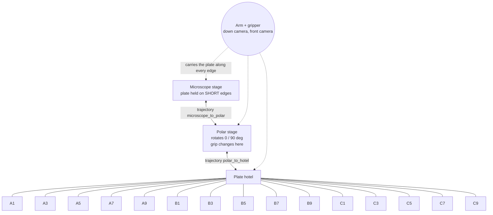

# nova_cell

Plate transfer cell on the Bioyond Nova SCARA arm: microscope stage, rotating (polar) stage, plate hotel.
Vision-gated, state-persisted, built to run unattended for days and to log the data that later
prediction models train on.

## Documents

- `docs/REPLICATION.md`: rebuild the cell from hardware to an unattended loop, step by step.
- `docs/VENDOR_SDK.md`: what the vendor .NET SDK really does (measured).
- `DESIGN.md`: gates, damage prevention, tolerance model, data contract, failure cases, tests.
- `ANALYSIS.md`: results of the first 90-hour unattended run and the plan derived from it.
- `STATUS.md`, `review_queue.py`: current state and decisions awaiting review.

## Topology



The arm is not a node. It is the agent that moves along the edges; the nodes are the places a plate can rest.
Each edge is one taught trajectory, replayed forward and in reverse.

## Cycle

```
microscope --pick(short edges)--> polar@0 --rotate 90--> pick(long edges) --> hotel slot
hotel slot --pick(long edges)--> polar@90 --rotate 0--> pick(short edges) --> microscope
```

Every fixture visit: travel, hover, vision check, lower, jaw action, jaw verification, lift, image.

## Layout

```
run.py                 command line
layout.json            every pose, floor, speed, limit and trajectory. Data, not code.
nova_cell/vision.py    VIBVision TCP client (vendor API, our code)
nova_cell/robot.py     the only module touching the vendor robot SDK; SimRobot behind the same interface
nova_cell/safety.py    speed profiles, workspace box, per-region z floors, vision jump limit
nova_cell/lower_check.py  cross-correlation "safe to lower" / "seated" / "held" gates
nova_cell/state.py     persisted cell state (where is the plate, what does the gripper hold)
nova_cell/predictor.py pre-step checks and drift statistics
nova_cell/corrector.py bounded recovery actions
nova_cell/trajectory.py hand-guided capture, multi-demo normalisation to waypoints
nova_cell/telemetry.py JSONL events + images per cycle
nova_cell/cycle.py     the loop
tests/test_sim.py      offline tests against the simulator and a fake vision box
```

## Commissioning order

1. `python run.py status`
2. Teach poses while hand-guiding: `python run.py record-pose microscope`, `polar.pose_at_0`, `polar.pose_at_90`
3. Record each route 2 to 3 times: `python run.py trace microscope_to_polar` (stop: create `runs/trace.stop`), then `python run.py normalise microscope_to_polar`; same for `polar_to_hotel`
4. Record "safe to lower" references at each fixture hover: `python run.py record-ref microscope plate_present` (3 or more each) for states `plate_present` and `empty`, plus `gripper short_edges` / `gripper long_edges` from the front camera
5. Set the microscope region box and z floor in `layout.json`
6. `python run.py run --mode supervised --slot A1 --cycles 1`
7. Only after the acceptance tests in DESIGN.md: `--mode unsupervised`

## Teaching quickly

`python teach_daemon.py` holds the one SDK connection and records a pose per word written to `runs/teach_cmd.txt`
(`A1`, `polar.pose_at_90`, `microscope`, `drag`, `undrag`, `status`, `quit`); `python record_slot.py A3` does one
hotel slot without the daemon. Both store pose, joints, jaw, stage reading and a frame from each camera under
`reference_images/teach/`. Hotel rows above 1 are reached by retreating to `fixtures.hotel.climb_x`, climbing with
the column only, and sliding in at carry height; `--slot random` draws from `fixtures.hotel.active_slots`.

A pick that stalls wider than the plate starts a tactile centering search (`fixtures.<name>.grasp_search`): the seat
is walked in small steps along z, yaw, x and y until the fingers meet the plate at its width, and the working pose
is written back to `layout.json`.

## Tests

`python tests/test_sim.py` runs the full cycle, a refused move, a missed grasp, a blocked lowering and a half-finished resume, all offline.
