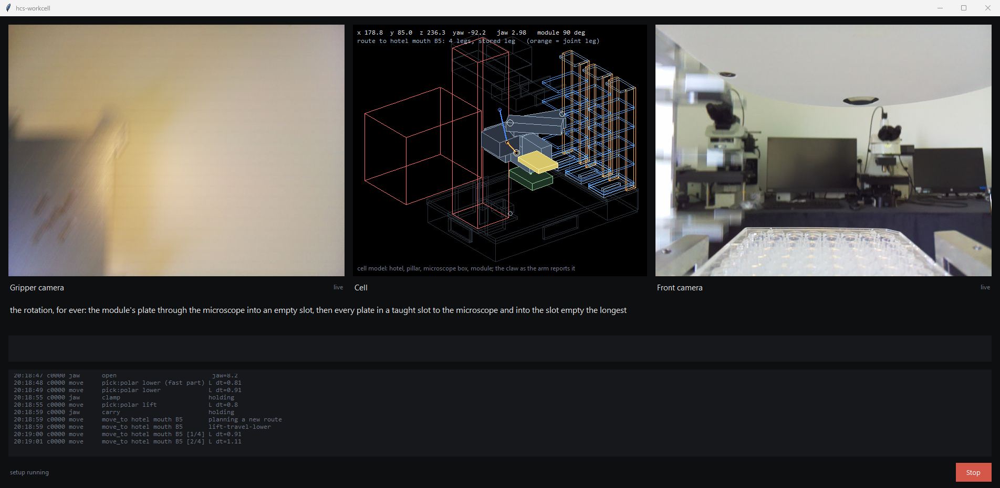
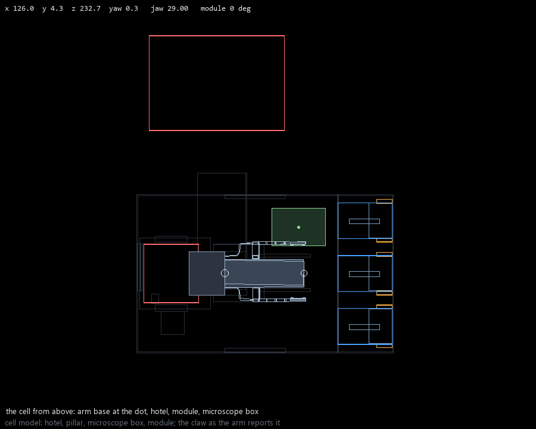
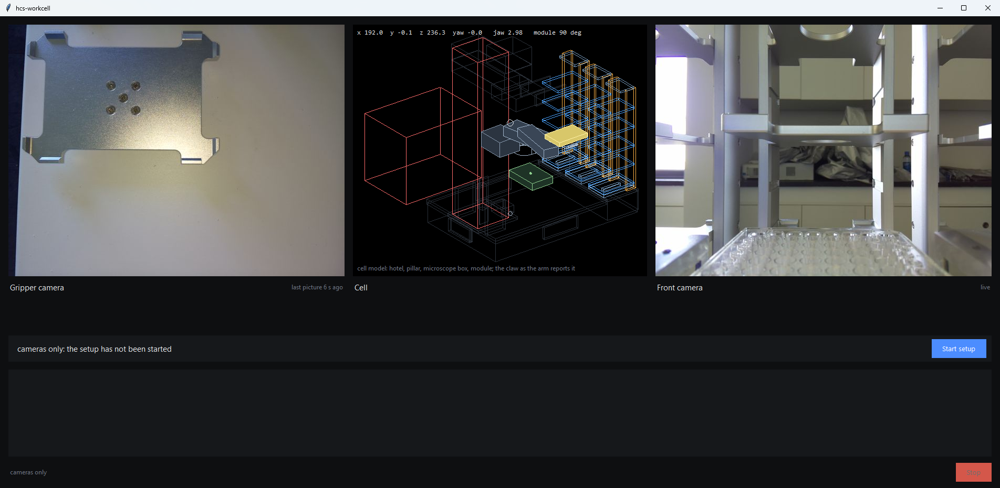
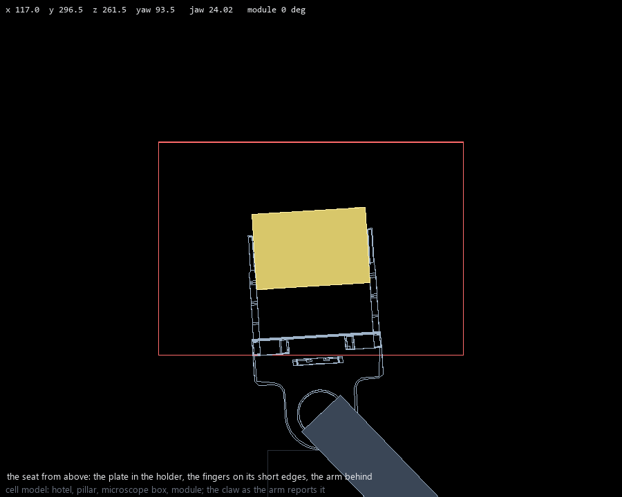
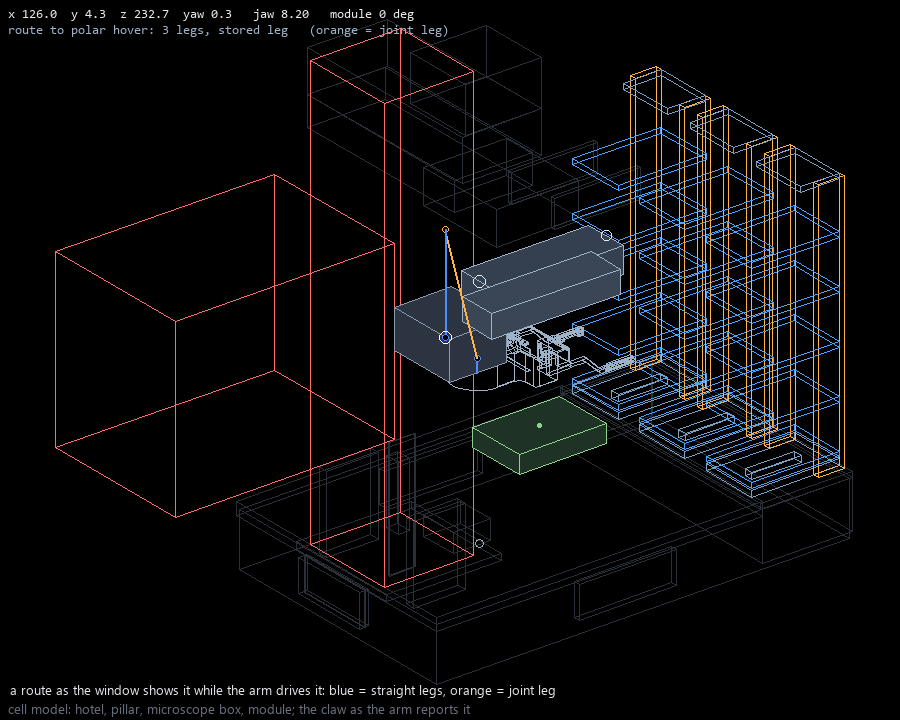

# hcs-workcell: making the arm work

A step-by-step guide for the person at the cell. It takes about ten minutes the first time. You do three things by hand: put the
plate in the microscope, bring the arm's fingers around it, press a button. The program does the rest and then keeps moving plates
between the hotel and the microscope until you stop it.



## 1. Before you start

Check, in this order:

1. **Power.** The arm's controller, the vision box (the small computer with the two cameras), the rotation module and the microscope
   PC are on. Wait a minute after switching the controller on.
2. **Network.** The PC that runs this program is on the same network as the controller and the vision box (one Ethernet cable to the
   cell's switch).
3. **The microscope** stands at least **20 cm** from the arm's base and its plate holder is within **39 cm** of the arm's axis. Nothing
   stands between the microscope, the rotation module and the hotel.
4. **One plate** is in the cell, on the rotation module. The hotel slots are empty.
5. **The emergency stop** is within reach. Keep a hand near it during the first run.



*The cell as the program sees it, from above: the arm's base is the dot, the hotel is on the right (blue trays), the rotation
module is the green square, the microscope's space is the red box.*

## 2. Open the window

Double-click **hcs-workcell** on the desktop. One window opens:



- **Left:** the camera that looks down from the arm's hand.
- **Middle:** a live model of the cell. The arm, the claw and the module move in it as they move in the cell.
- **Right:** the camera that looks forward along the fingers.
- **Under the pictures:** one line that says what is happening now.
- **The blue button bar:** when the program needs you, the question appears here with a button. Press the button, or press Enter.
- **The log:** everything the program does, one line per move. Scroll up to read back; it follows the newest line again when you
  scroll to the bottom.
- **Stop** (bottom right): stops the program at once. The arm stops where it is.

The setup starts by itself when the window opens from the desktop icon (the "Start setup" button above is what you see if the
window was opened for the cameras only).

## 3. The steps

The program runs four sections. Each one prints its name in the log (`== connect`, `== microscope seat` ...). You act only when the
blue bar asks.

### connect (automatic)

The program finds the controller and the vision box on the network and homes the microscope stage. The arm does not move.
About 20 seconds.

If it says **no controller answers**: check the controller's power and the cable, wait a minute, press **Start over**.

### microscope seat (you, then the arm)

The arm goes **loose**: you can move it by hand. The blue bar says what to do:

1. Take the plate off the rotation module and set it flat in the microscope's plate holder, the way it will sit for imaging.
2. Hold the claw by its body and bring it over the plate so that the two fingers are at the plate's **short edges**, the claw
   square to the microscope. The fingers are open; they do not need to touch the plate. Lower the claw until the fingers are at the
   plate's height, as if about to grip it.
3. Look at the wrist: it must not be wound more than half a turn. If the cables are twisted, turn the claw back the other way.
4. Take your hands away and press **Done**.



*What you are teaching: the plate in the holder (yellow), the fingers at its short edges, the arm behind.*

Then the arm takes that pose as the microscope seat, lets go, rises straight up, and **proves the seat**: it comes back down,
closes the fingers on the plate by force, lifts the plate, sets it back and opens all the way. This first clamp also teaches the
program how wide the plate is. Keep your hands away from now on.

If it says **the wrist is wound**: the claw was turned too far. Turn it back by hand (the arm is still loose), press Done again.

If it says **the hand is ... mm from the arm's axis**: the microscope stands too close to the arm. Move it to at least 20 cm from
the base and start this section again (the button says **Resume at microscope seat**).

### microscope.toml (automatic)

The program reads the stage's travel limits from the microscope software. Nothing moves.

### test (the arm, for ever)

The rotation. First the plate goes from the module through the microscope into an empty slot of the hotel. Then, for ever: a
plate leaves its slot, goes to the module, is turned, goes onto the microscope, comes back through the module and into the slot
that has been empty the longest. One round takes about three minutes.

Watch the first round with a hand near the emergency stop. After that it runs alone. The model in the middle shows every route
before the arm drives it (blue lines: straight; orange: a turn of the joints).



## 4. Stopping

- **Stop** button: the arm stops at once, wherever it is. Use it when something looks wrong.
- To stop **between two plates**, with the plate safely in a slot: create an empty file named `STOP` in the folder `runs`
  (next to the program). The program finishes the plate it is carrying and stops. Delete the file before the next start.

## 5. When it stops by itself

A red line in the log starts with `REFUSED` or `FAILED` and says what is wrong. Below it the program says where to continue
(`python cli.py setup --from "test"`), and the blue bar shows a **Resume at ...** button for that section. Fix what the line says,
then press the button.

| the red line says | what it means | what to do |
|---|---|---|
| no controller answers | the controller is off, or not on the network | power and cable, wait a minute, Start over |
| the wrist is wound | the claw was turned more than half a turn | turn the claw back by hand, Done |
| nothing clamped in two closes | the arm closed its fingers where it expected a plate and found none | look where the plate is; put it where the program expected it (the slot or the module it names), then Resume |
| the plate is not in the claw | the plate slipped during a carry | find the plate, put it back on the module, Resume at test |
| the force clamp failed | the controller cut the connection | press Resume; if it repeats, restart the controller |
| soft limit / collision / controller error | the arm hit something or reached the end of a joint | press Stop, free the arm by hand if needed, run the recovery below, then Resume |

**Recovery after a collision.** Open a terminal in the program's folder and run:

```
python cli.py recover
```

It clears the controller's errors and leaves the arm loose, so you can move it by hand to a free place. `python cli.py recover --nest`
also drives it to its rest pose in front of the hotel (only with an empty claw).

**A plate left in the claw.** Never leave a plate in a stopped claw for long: the controller may relax the grip after some minutes.
Take it out by hand (the arm is loose after `recover`) and put it on the module.

## 6. Running again later

- **Only the loop**, with the seat already taught: desktop icon **hcs-workcell run**. It opens the same window and starts at the
  test section. The plate must be on the module or in a hotel slot the program knows about.
- **The microscope was moved**, or the fingers or the plate changed: desktop icon **hcs-workcell** runs the whole setup again from
  the start. The seat is taught again; the stored routes that depend on it are planned again on the first round.

## 7. Where things are written

| what | where |
|---|---|
| the log of the last run, as in the window | `runs/setup_console_<date>_<time>.log` |
| every move with times and positions | `runs/setup_<date>_<time>/events.jsonl` |
| what the setup learned (seat, plate width, routes) | `layout.json`, `station_graph.json` |
| where the plate is, as the program believes it | `state_microscope.json` |

If the program's idea of where the plate is does not match the cell (for example after you moved a plate by hand), put the plate on
the module and start the window with **hcs-workcell run**: the test section starts from a plate on the module.
