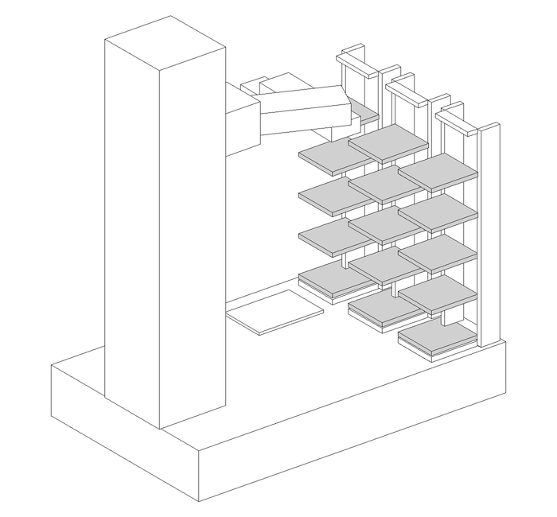
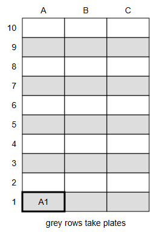
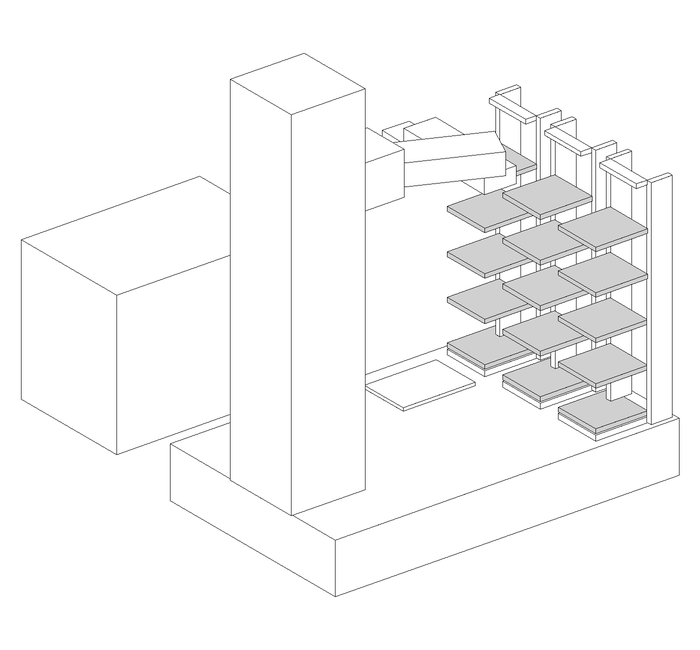

# Setup

## Prerequisites

- BioyondWorks, installed on the PC.
- The Bioyond Python package (a .whl file). Contact us or Bioyond to get it.
- Python 3.10 or newer.
- Run `.\install.ps1 -SdkWheel <path to the .whl file>`.
- Close BioyondWorks.

## Hardware

1. Connect the power cable and the emergency stop to the arm. Turn on the main switch at the back. Wait until the status light is steady.
2. Connect the PC to port 1 of the controller with a network cable.
3. Screw the hotel onto the platform. The slots face the arm.
4. Load the plates into the hotel. Start at A1.

5. Place the ArUco plate on the rotation module.

## Setup

Run `python cli.py setup`. The script ends with `READY`.

## Setup script in a nutshell

- Upload some preset knowledge to the arm:
    - hotel slot positions
    - rotation module seat positions
    - long-edge grip, short-edge grip, and grip torque probe procedure
    - hotel slot exit/entry procedure
    - routes from each slot ↔ rotation module
- Calibrate cameras:
    - Run aruco intrinsic and extrinsic calibration
    - Upload values to BioyondWorks

# Teaching

## Hardware

1. Place the microscope next to the platform.
2. Place a real plate in the microscope's plate holder.

## Teaching

1. Run `python cli.py teach`. The arm goes loose.
2. Move the arm by hand until the gripper grabs the plate by its short edges.
3. Press Enter. The script ends with `READY`.

## Teaching and route planning script in a nutshell

- User teaches microscope seat
    - gripper grabbing a real plate by short edges
- Planner runs and uploads route: microscope seat ↔ rotation module

Test: take the plate from the microscope to the rotation module.
