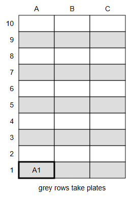
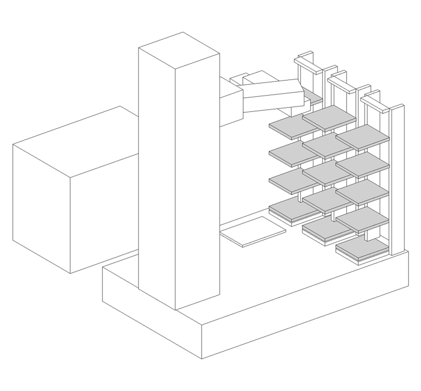

> Deprecated on 2026-11-10. The guide is the [README](../README.md); this page is no longer updated.

# Workflow

## Prerequisites

- BioyondWorks, installed on the PC.
- The Bioyond Python package (a .whl file). Contact us or Bioyond to get it.
- Python 3.10 or newer.
- Run `setup\install.bat <path to the .whl file>`.
- Close BioyondWorks.

## Hardware
1. Connect the power cable and the emergency stop to the arm. Turn on the main switch at the back. Wait until the status light is steady.
2. Connect the PC to port 1 of the controller with a network cable.
3. Screw the hotel onto the platform. The slots face the arm.
4. Load the plates into the hotel. Start at A1.




## Setup

Run `python cli.py setup`. The script ends with `READY`.

## Setup script in a nutshell

- Upload some preset knowledge to the arm:
    - hotel slot positions
    - rotation module seat positions
    - long-edge grip, short-edge grip, and grip torque probe procedure
    - hotel slot exit/entry procedure
    - routes from each slot ↔ rotation module

# Teaching

## Hardware



1. Place the microscope next to the platform, at least 20 cm from the arm's base. The plate holder must be within 39 cm of the arm's axis.
2. Place a real plate in the microscope's plate holder.

## Teaching

1. Run `python cli.py teach`. The arm goes loose.
2. Move the arm by hand until the gripper grabs the plate by its short edges.
3. Press Enter. The script ends with `READY`.

## Teaching and route planning script in a nutshell

- User teaches microscope seat
    - gripper grabbing a real plate by short edges
- Planner: microscope seat ↔ rotation module routes
- Upload routes and microscope seat to the arm

# Running jobs

## Demo

Run `python demo.py`. The arm takes the plate from A1 to the microscope and back.

## Your own script

```python
from polar import Polar

arm = Polar(plate_at="A1")

arm.move("A1", "microscope")
arm.move("microscope", "A1")
```

- `arm.move(source, destination)` picks the plate at the source and places it at the destination.
- `arm.pick(place)` and `arm.place(place)` do one half each.
- `plate_at` says where the plate is when the script starts. Leave it out and the arm remembers from the last run.
- A place is a hotel slot (`"A1"` to `"B9"`), `"module"`, or the name of an instrument you taught. Column C does not work yet.
- Each call returns when the arm is done. It raises an error with the reason if it cannot do it.

## Jobs in a nutshell

- The script sends one job to the arm: source, destination
- The arm runs the stored routes and the entry and seating procedures
- The arm replies done, or the reason it stopped
